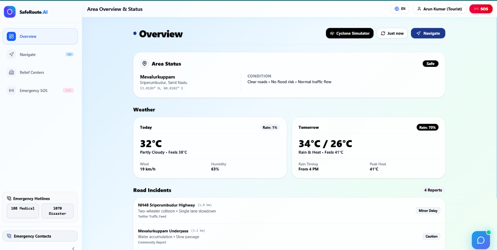
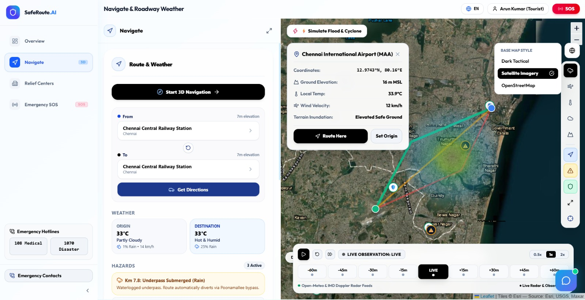
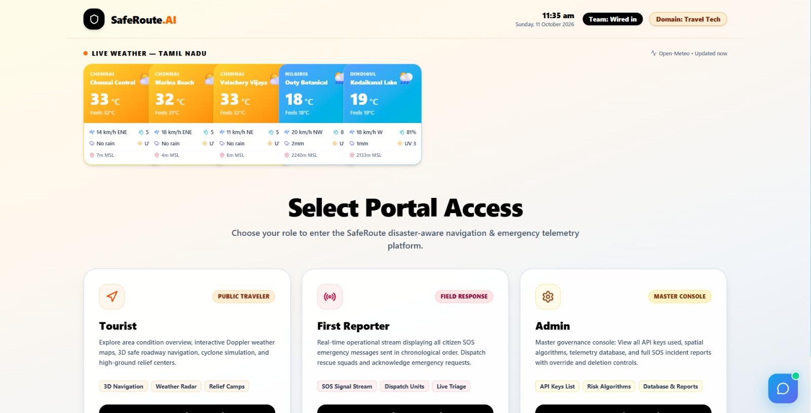
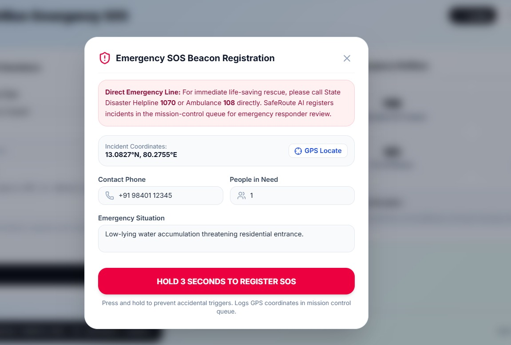
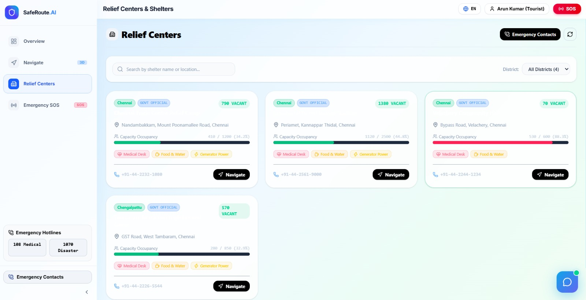
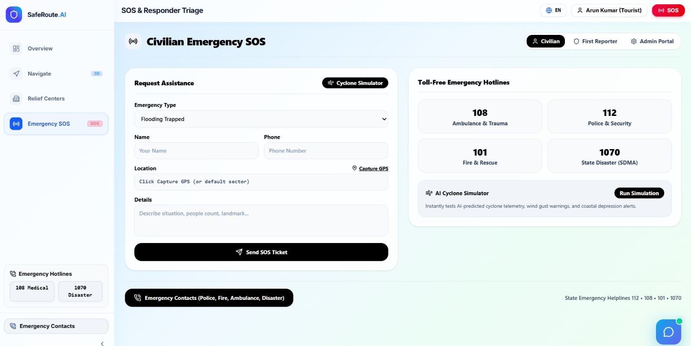

SafeRoute AI 🌍

DEPLOYED LINK: https://saferoute-wired-in.vercel.app/

PRESENTATION VIDEO LINK: https://drive.google.com/drive/folders/1M4_MOVI5nDY9IDSMED_CVw8Lpemh3GxY?usp=sharing

</div>

---

## 🌐 Overview

SafeRoute AI is a disaster-aware navigation and emergency-coordination prototype designed to help people make more informed travel decisions during severe weather and other hazardous situations.

The platform brings together candidate route generation, hazard information, weather context, official-alert integrations, and a deterministic route-risk assessment engine. It evaluates available routes, explains contributing risk factors, and provides route-risk summaries in English and Tamil.

The broader application also includes interfaces and backend APIs for emergency SOS reports, incidents, relief centres, responders, simulations, and administration.

> **Safety notice:** SafeRoute AI is a decision-support prototype. It cannot guarantee a safe route and must not replace official evacuation instructions or emergency services. In an immediate emergency in India, call **112** and follow instructions from local authorities.

## ✨ Key Features

### 🗺️ Navigation and route-risk assessment
- Generates candidate routes through the configured routing integration.
- Assesses candidate routes using a deterministic, rule-based risk engine.
- Considers configured hazard severity, verification status, freshness, proximity, weather context, and geographic vulnerability rules.
- Can identify candidate routes affected by qualifying critical road closures.
- Presents route-risk categories and explanations to help users understand contributing factors.

### 🌦️ Weather and hazard context
- Weather integration configured for Open-Meteo.
- Routing integration configured for OSRM.
- Geocoding integration configured for Nominatim.
- Official-alert integration configured for the NDMA SACHET/CAP feed.
- Hazard and incident-reporting workflows for structured emergency information.

External services and feeds may be delayed, incomplete, unavailable, or subject to provider limitations.

### 🚨 Emergency SOS and responder workflows
- Civilian emergency assistance form and SOS workflow.
- Location/GPS capture interface.
- Emergency hotline information.
- Backend APIs for incidents, reports, responders, and administrative operations.
- SOS beacon registration interface for recording incident details and coordinates.

**Important:** The screenshots show the application interface. They do not by themselves establish that every SOS submission reaches a live responder or that a real-world rescue dispatch is performed.

### 🏠 Relief centres
- Relief-centre listings with location, occupancy, and service information.
- Search and district-filter interface.
- Navigation action from a relief-centre card.

Verify centre locations, occupancy, contact numbers, and service availability with authoritative sources before relying on them during an emergency.

### 🌐 Bilingual experience
- English and Tamil route explanations.
- Frontend translation dictionaries intended to make disaster-related information more accessible.

### 🔐 Authentication and service health
- Registration and login endpoints.
- Bearer-token authentication.
- Authenticated user-profile endpoint.
- API liveness and readiness checks.

Privileged roles must be provisioned securely. Public registration must not allow users to assign themselves administrator or responder privileges.

## 🖼️ Screenshots

The screenshots below are included in the [`screenshots/`](screenshots/) directory. They document the visible UI and are not a substitute for functional testing.

### Application overview


### Navigation, weather and route-risk interface


### Portal access


### Emergency SOS and responder triage


### Relief centres


### SOS beacon registration


## 🧠 How Route Risk Assessment Works

The route-assessment endpoint is:

```http
POST /api/v1/routes/assess
```

The documented workflow is:

1. Request candidate routes from the routing integration.
2. Retrieve relevant hazard records near the route origin.
3. Collect available weather forecast and official-alert context.
4. Evaluate candidate routes using the versioned `RouteRiskEngine`.
5. Store the resulting assessment and contributing hazard evidence.
6. Return risk categories, explanations, weather context, data provenance, and known limitations.

### Risk factors

The deterministic risk engine considers configured factors including:

- Hazard severity and verification status.
- Hazard type and configured penalty weights.
- Distance between route geometry and relevant hazards.
- Hazard freshness and stale-data decay.
- Rainfall and wind thresholds.
- Active-alert counts.
- Configured geographic vulnerability rules.
- Qualifying verified critical road closures.

Risk categories include `LOW`, `ELEVATED`, `HIGH`, and `CRITICAL`.

**Model transparency:** These scores are heuristic estimates, not calibrated probabilities. Do not describe the current risk engine as a trained machine-learning prediction model unless a separately implemented and evaluated model supports that claim.

Some geographic vulnerability rules use hard-coded coordinate ranges and representative elevation values; they are not a comprehensive live elevation-data service.

## 🏗️ Architecture

```text
React + TypeScript Frontend
  ├── Map and navigation interface
  ├── Risk displays and hazard context
  ├── Emergency SOS and relief-centre views
  └── English/Tamil interface and API client
                │
                │ REST API
                ▼
FastAPI Backend
  ├── Authentication and health
  ├── Routes, weather and alerts
  ├── Hazards, reports and incidents
  ├── Shelters and responders
  ├── Simulations and guidance
  └── Administration
                │
      ┌─────────┼──────────┐
      ▼         ▼          ▼
 Risk engine  Data layer  External services
 Shapely      SQLAlchemy  Open-Meteo
              Alembic     OSRM
              SQLite /    Nominatim
              PostgreSQL  NDMA SACHET/CAP
```

The project README describes 13 functional API routers covering health, authentication, weather, alerts, routes, hazards, reports, shelters, incidents, responders, simulations, guidance, and administration. Confirm the current source tree for the authoritative implementation.

## 🧰 Technology Stack

| Component | Technologies |
|---|---|
| Frontend | React, TypeScript, Vite |
| UI and styling | Tailwind CSS, Lucide React |
| Mapping | Leaflet |
| Navigation | React Router |
| Backend | Python, FastAPI, Uvicorn |
| Validation | Pydantic v2 |
| Database layer | SQLAlchemy |
| Migrations | Alembic |
| Local database configuration | SQLite |
| Container database configuration | PostgreSQL/PostGIS |
| Geospatial processing | Shapely |
| Weather integration | Open-Meteo |
| Routing integration | OSRM |
| Geocoding integration | Nominatim |
| Official alerts | NDMA SACHET/CAP integration |
| Optional caching | Redis |
| Deployment tooling | Docker, Docker Compose |

## 📁 Repository Structure

```text
Saferoute_ai/
├── backend/
│   ├── app/
│   │   ├── api/v1/
│   │   ├── core/
│   │   ├── models/
│   │   ├── repositories/
│   │   ├── services/
│   │   └── main.py
│   ├── alembic/
│   ├── tests/
│   ├── requirements.txt
│   └── seed.py
├── frontend/
│   ├── src/
│   ├── package.json
│   └── vite.config.ts
├── screenshots/
├── .env.example
├── .gitignore
├── docker-compose.yml
└── run_dev.ps1
```

This is a documented overview. Check the repository for the exact current paths and files.

## 🚀 Run Locally

### Prerequisites
- Python 3.12 recommended, subject to the versions supported by the current dependencies.
- Node.js compatible with the frontend dependencies.
- Git.
- Optional: Docker Desktop.

### 1. Clone the repository

```bash
git clone https://github.com/prithviraajkumarl/Saferoute_ai.git
cd Saferoute_ai
```

### 2. Configure and start the backend

```bash
cd backend
python -m venv .venv
```

Activate the environment.

**Windows PowerShell**
```powershell
.\.venv\Scripts\Activate.ps1
```

**macOS/Linux**
```bash
source .venv/bin/activate
```

Install dependencies and start the API:

```bash
python -m pip install --upgrade pip
pip install -r requirements.txt
uvicorn app.main:app --host 127.0.0.1 --port 8000 --reload
```

Review the backend configuration and supply the required environment variables before starting. Do not use example secrets in a public deployment.

When the backend is running locally:

- Swagger UI: http://127.0.0.1:8000/docs
- ReDoc: http://127.0.0.1:8000/redoc
- Liveness: http://127.0.0.1:8000/api/v1/health/liveness
- Readiness: http://127.0.0.1:8000/api/v1/health/readiness

> **Demo-data warning:** Review `backend/seed.py` before running it. Never run demo seed scripts against a production database. Clearly label seeded or simulated incidents.

### 3. Start the frontend

Open a second terminal from the repository root:

```bash
cd frontend
npm install
npm run dev
```

Open the local URL printed by Vite, commonly http://localhost:5173. The development Vite configuration is documented as proxying `/api` requests to the local backend; verify this against the current configuration.

### 4. Build and test

Run frontend commands declared in `frontend/package.json`:

```bash
npm run build
npm test
npm run lint
```

Run backend tests from the `backend/` directory:

```bash
pytest
```

These are validation commands, not claims that tests have already passed. Report successful builds, test counts, and coverage only when supported by actual output or CI results.

## 🔌 API Highlights

The backend exposes versioned routes under `/api/v1`.

| Method | Endpoint | Purpose |
|---|---|---|
| `GET` | `/api/v1/health/liveness` | Process liveness |
| `GET` | `/api/v1/health/readiness` | Service/database readiness |
| `POST` | `/api/v1/auth/register` | Account registration |
| `POST` | `/api/v1/auth/login` | User authentication |
| `GET` | `/api/v1/auth/me` | Authenticated user profile |
| `GET` | `/api/v1/routes/policy` | Route-risk policy |
| `POST` | `/api/v1/routes/assess` | Candidate route-risk assessment |
| `GET` | `/api/v1/routes/geocode?query=...` | Place geocoding |

Use the running Swagger UI to inspect the current request schemas, response models, authentication requirements, and other endpoints.

## 🔒 Security and Safety

Before public deployment:

- Generate a strong JWT signing secret and keep it outside source control.
- Store database credentials and other secrets in environment-managed configuration.
- Never publish working administrator or responder credentials in this README.
- Ensure public registration cannot assign privileged roles.
- Restrict PostgreSQL and Redis ports to trusted networks.
- Do not expose the Vite development server to untrusted networks.
- Label generated, seeded, and fallback emergency records as simulated.
- Display a clear unavailable/offline state when live feeds or the backend cannot be reached.
- Validate authorization, incident privacy, rate limits, and input handling.
- Exclude tracked virtual environments and generated files from Git.

If a committed secret or demonstration password has been used on a deployed service, rotate it. Removing it from the latest README alone is not sufficient.


## 👥 Team

- **Abishek** 
- **Prithvi Raaj Kumar** 

<div align="center">

**SafeRoute AI — Navigate with awareness. Respond with confidence.**

